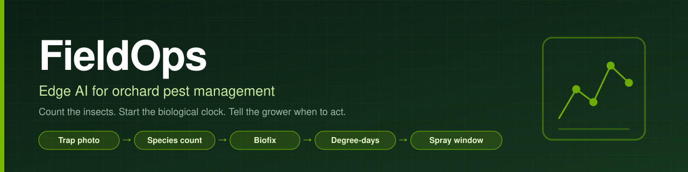

<p align="center">
  
</p>

# FieldOps: Edge AI for Orchard Pest Management

**Count the insects. Start the biological clock. Tell the grower when to act.**

FieldOps turns sticky-trap photos and seasonal weather into a clear treatment window. Built by a
four-person team in 24 hours for the invite-only Dell x NVIDIA AI Hackathon in Cambridge,
Massachusetts, on October 3, 2026, it brings computer vision, deterministic pest modeling, and a
local language model together on a Dell GB10 with NVIDIA Grace Blackwell.

The season replay—the core demo—runs locally without live inference or a network connection.
Telegram photo transport and phone alerts require internet access.

**[Final presentation](pitch/2026-10-03-fieldops.html)** ·
[Two-minute demo film](pitch/video/fieldops-demo.mp4) ·
[Presenter runbook](pitch/DEMO.md)

## What it does

- **Counts pests from trap photos.** YOLO26s identifies codling moths, oriental fruit moths, and
  spotted lanternflies while treating gnats and debris as separate classes.
- **Finds biofix.** The decision engine detects the first sustained catch that starts the pest's
  biological clock.
- **Tracks degree-days.** Daily high and low temperatures drive an auditable, species-specific
  model.
- **Calls the treatment window.** When accumulated degree-days cross the configured threshold,
  FieldOps identifies the spray window.
- **Explains the result.** A local LLM phrases alerts and answers questions such as “Why Thursday?”
  It reads the decision; it does not calculate it.

> **The counting is the party trick. The decision is the product.**

## How it works

```text
Trap photo ──▶ YOLO26s vision ──▶ Species counts ──▶ SQLite store ──┐
                                                                    │
Daily temperatures ────────────────────────────────────────────────┴──▶ Python decision engine
                                                                            │
                                                                            ▼
                                                            Local LLM phrases the result
                                                                            │
                                                                            ▼
                                                               Telegram alert to grower
```

The replay uses committed seasonal data and deterministic Python. It does not depend on the camera,
vision model, or LLM, so a live-service failure cannot break the demo. Photo counts only enter the
store when explicitly requested.

<details>
<summary>Architecture and reliability</summary>

The system keeps decision-making separate from language generation:

1. **The decision engine owns the numbers.** Biofix, degree-days, and spray-window thresholds are
   calculated in plain Python using species configuration. The result is deterministic and
   auditable.
2. **The LLM is the translator.** It turns decision results into grower-facing language and
   answers follow-up questions. It does not decide when to spray or compute the metrics.

The replay lane runs from the committed `data/season.csv` through SQLite and `decide` to the
dashboard timeline. The live lane accepts a Telegram photo, runs YOLO26s, and returns counts.
Live counts are opt-in for the store, so a demo photo cannot shift replay dates.

</details>

## Vision results

YOLO26s was evaluated on 200 held-out, phone-style synthetic trap photos. Fine-tuning on
phone-style images substantially reduced counting error compared with the clean-card model:

| Pest | Clean-card model MAE | Phone-fine-tuned MAE | Exact counts |
|---|---:|---:|---:|
| Codling moth | 3.67 | **0.07** | 189 / 200 |
| Oriental fruit moth | 4.65 | **0.04** | 192 / 200 |
| Spotted lanternfly | 0.12 | **0.00** | 200 / 200 |

These are best-case results: the phone-style test uses image effects similar to those used during
fine-tuning. Accuracy on photos of real traps has not yet been measured.

<details>
<summary>How the vision model was evaluated</summary>

The detector is trained on synthetic trap cards with exact labels. A clean synthetic validation
set initially gave an impressive score but did not predict performance on phone-style photos.
FieldOps added a separate, seed-held-out phone-photo stress test and fine-tuned the model against
phone-style images. The results above are from that test, not real orchard traps.

See the [vision model notes](fieldops/yolo/README.md) for the training setup, data splits, and
evaluation commands.

</details>

## GB10 stack

The product's inference and decision path is designed to run locally:

- **Hardware:** Dell GB10 development platform with NVIDIA Grace Blackwell.
- **Vision:** Ultralytics YOLO26s on the GPU.
- **Language model:** Qwen3.6-35B-A3B in NVFP4 format, served locally with vLLM.
- **Decision and storage:** Python and SQLite.
- **Agent and sandbox:** NemoClaw, OpenClaw, and OpenShell.
- **Speech:** Kokoro local speech synthesis.

Telegram delivery uses Telegram's service and therefore requires a network connection. See
[ORCHESTRATION.md](ORCHESTRATION.md) for process details, ports, and offline behavior.

<details>
<summary>Start services automatically on the GB10</summary>

The GB10 deployment installs `fieldops.target` as systemd user services for the OpenClaw sandbox,
vision service, and tools API:

```bash
bash deploy/install.sh
```

See [deploy/README.md](deploy/README.md) for prerequisites and service management.

</details>

## Quick start

Run from the repository root. The local model and GPU vision commands require the GB10 environment;
the season replay and dashboard can run independently.

<details>
<summary>1. Check local models and configure Telegram</summary>

```bash
# Check that the local LLM and vision model load
python -m fieldops.check_models

# One-time setup for phone alerts
python -m fieldops.telegram_setup
```

Telegram setup and delivery require network access.

</details>

<details>
<summary>2. Build the season data and store</summary>

```bash
# Regenerate the committed synthetic season data
python -m fieldops.season

# Fetch historical temperature normals (requires network access)
python -m fieldops.weather --normals

# Build the SQLite store from the season CSV
python -m fieldops.store --load data/season.csv
```

</details>

<details>
<summary>3. Replay the decision and run the local API</summary>

```bash
# Run decision self-tests and write the dashboard timeline
python -m fieldops.decide --replay

# Start the tools API and dashboard alert endpoint
python -m fieldops.api
```

Open `dashboard/index.html` to play the season replay. The replay does not require the API, live
vision, or a language model.

</details>

<details>
<summary>4. Run live vision and evaluation</summary>

These commands use the GPU vision container. See
[fieldops/yolo/README.md](fieldops/yolo/README.md) for container setup.

```bash
# Start the vision service
bash fieldops/yolo/run.sh serve

# Evaluate the reference trap cards
bash fieldops/yolo/run.sh eval

# Run the 200-image phone-style stress test
bash fieldops/yolo/run.sh phone-test --n 200
```

</details>

## Project guide

| Path | Description |
|---|---|
| [ORCHESTRATION.md](ORCHESTRATION.md) | Processes, ports, data flow, and failure modes |
| [PLAN.md](PLAN.md) | Implementation plan and remaining work |
| [AGENTS.md](AGENTS.md) | Integration contracts and coding conventions |
| [dashboard/TIMELINE_CONTRACT.md](dashboard/TIMELINE_CONTRACT.md) | Decision-to-dashboard timeline contract |
| [fieldops/yolo/README.md](fieldops/yolo/README.md) | Vision training, evaluation, and GPU setup |
| [deploy/README.md](deploy/README.md) | GB10 systemd installation |

## Limitations

- The replay uses a committed synthetic season; field accuracy, yield impact, and time savings have
  not been validated with growers.
- Detector metrics are from synthetic and phone-style synthetic images, not real orchard traps.
- The replay works offline, but Telegram photo transport and phone-alert delivery require a network.

## Team

| Name | GitHub |
|---|---|
| Himanshu | [@hnagpa](https://github.com/hnagpa) |
| Jen Kelleman | [@jkelleman](https://github.com/jkelleman) |
| Piyush Dubey | [@piyushdubey](https://github.com/piyushdubey) |
| Rishab Nayak | [@rishabnayak](https://github.com/rishabnayak) |

## License

MIT — see [LICENSE](LICENSE).
